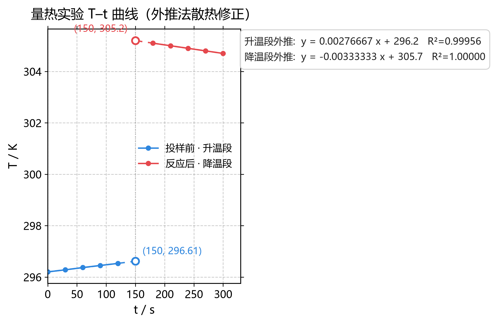

# 外推法作图 · Extrapolation Plotter

一个类似 Origin 的实验数据作图工具：导入 XY 数据后，调好两轴刻度、点线样式、标题图例，就能直接出图；内置**分段线性拟合 + 外推**，特别适合大学物理实验里的散热修正（升温段/降温段分别外推到投样时刻求修正温升），也支持通用线性外推求 x 截距。

图形界面用真 **WinUI3（`Microsoft.UI.Xaml`）** 编写（PyWinRT 的 Python 投影），绘图与导出由 matplotlib 完成，导出 PNG/SVG/PDF 与预览完全一致。



## 快速开始

**方式 A：直接用 exe（推荐）**

到 [Releases](https://github.com/kun-qaq/extrapolation-plotter/releases) 下载 `ExtrapolationPlotter.exe`，双击即可，不需要 Python。首次启动冷启动约 2–5 秒（单文件自解压）。

> 换电脑运行需要该机器已安装 **Windows App SDK 运行时**（开发机是 2.6.5）。

**方式 B：跑源码**

```bat
run.bat
```

或命令行：

```bat
.venv\Scripts\python.exe main.py
```

依赖见 `requirements.txt`（主要是 PyWinRT 的 WinUI3 投影包 + matplotlib + numpy）。

## 界面与用法

窗口左侧是 5 个设置页，右上是实时预览，右下是拟合结果，顶部有状态栏和「实时预览」开关。

1. **数据输入**：点「载入示例」可直接看效果（量热实验 T–t 数据）；或直接把 Excel 两列粘进文本框（Tab / 空格 / 逗号 / 中文分号都认，表头自动跳过）。支持 6 个序列槽、CSV/TXT 绝对路径载入。只给一列时 X 自动取 1,2,3…
2. **坐标轴**：图标题、X/Y 轴标签、范围（留空=自动）、主刻度间隔、次刻度细分、主次网格线与线型/透明度、刻度朝内、上右边框、边框线宽。
3. **曲线样式**：**按序列独立**的点型/大小、线型/线宽、颜色、误差棒；以及字体字号、画布英寸、DPI、图例位置、透明背景。
4. **外推拟合**：两段可独立启用，各选拟合的数据序列与 x 区间（只取线性区），填「外推到 x」即给出该处的外推值、方程、R²、斜率/截距不确定度；可勾选 y=0 截距、外推点标注、两段差值 Δy。
5. **导出保存**：PNG / SVG / PDF（130–600 DPI，SVG/PDF 为真矢量）、数据与拟合结果 TXT、工程 JSON 存取。

任何改动 230 ms 后自动重绘；关掉「实时预览」可手动点「立即刷新预览」。

## 示例结果

`samples/calorimetry_demo.csv` 是量热实验的 T–t 数据。两段直线外推到 t = 150 s：

| 量 | 值 |
|---|---|
| 升温段外推 T_A | 296.615 K |
| 降温段外推 T_B | 305.200 K |
| Δy（修正温升） | −8.585 K |

## 重新打包

```bat
build_exe.bat
```

默认出 `dist/ExtrapolationPlotter\`（onedir）；设 `EXTRAP_ONEFILE=1` 后重跑可出单文件版。配置在 `build_exe.spec`。

## 已知限制

- 只做**线性**最小二乘外推，最多 6 组数据。
- 预览是 matplotlib 位图送进 WinUI3 的 `Image` 显示，**不能像 Origin 在图上拖点**，交互都在左侧参数面板。
- 没有系统文件对话框：CSV 路径、输出目录、工程路径都手填绝对路径。
- 图里要中文，字体选「微软雅黑」或「宋体 + Times」；纯英文字体会出方框。
- 方程/R² 文本框放在图外右侧避免遮挡数据，可在拟合页关闭。

## 文件结构

| 文件 | 作用 |
|---|---|
| `main.py` | WinUI3 窗口、XAML 加载、控件事件与实时预览 |
| `ui.xaml` | 界面（NavigationView + 卡片设置页） |
| `core.py` | 数据序列、最小二乘拟合、外推与结果计算 |
| `plotter.py` | matplotlib 出图、样式与导出 |
| `build_exe.spec` / `build_exe.bat` | PyInstaller 打包 |
| `samples/` | 示例 CSV 与示例出图 |
